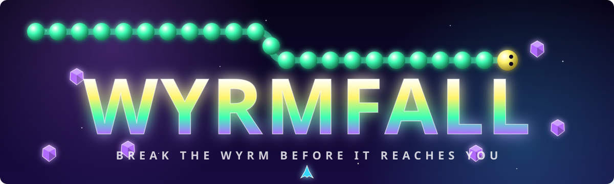
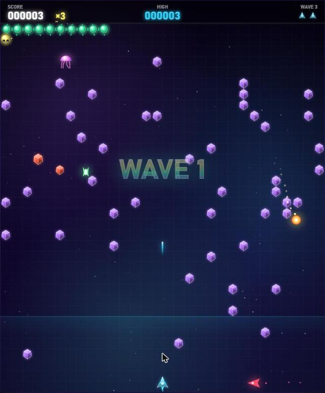

<p align="center"></p>

<p align="center">
  <b>A neon arcade shooter in the spirit of the golden-age cabinets.</b><br>
  One ship. One shot on screen. One very long, very angry wyrm.
</p>

<p align="center">
  <code>zero dependencies</code> · <code>zero build step</code> · <code>zero asset files</code> · <code>~900 lines of vanilla JS</code>
</p>

---

## Play it

```
double-click index.html
```

That's the whole install. No npm, no bundler, no server. It runs from `file://` in any modern browser, on desktop or phone.

<p align="center"></p>

## What is this?

WYRMFALL is a love letter to the early-80s fixed shooter: a segmented creature winds down through a field of obstacles while you dart around the bottom of the screen, picking it apart link by link. The feel is deliberately old-school — instant response, a single bullet that rewards point-blank nerve, a bass pulse that quickens as the danger drops toward you.

Everything else is new. The name, the cast, the art and the sound are original to this game, and it adds a few things a 1980 cabinet never had: chain multipliers, volatile crystals that set off chain reactions, and a screen-clearing Nova you charge with kills.

## Controls

| Action | Mouse | Keyboard | Touch |
| --- | --- | --- | --- |
| Move | Move the pointer | `WASD` / arrow keys | Drag anywhere |
| Fire | Hold left button | Hold `Space` | Hold a finger down |
| Nova (when charged) | Right-click | `Shift` or `X` | Tap a second finger |
| Pause | Click to resume | `P` / `Esc` | — |
| Mute / Fullscreen | — | `M` / `F` | — |

Mouse is the way to play. The ship chases the pointer at 1,700 px/s, which is as close to a trackball as a browser gets.

## How it works

**The wyrm** pours in from the top and marches sideways. Every time it meets a crystal or a wall it drops a row and reverses. Shoot a link and it hardens into a crystal — and the wyrm splits in two, each half with its own head. Clear every link to finish the wave.

**The home zone** is the bottom seven rows. You can roam it freely; so can a wyrm that reaches the floor, which then bounces around down there with you while reinforcements start arriving from the sides.

**One shot at a time.** Your next bullet can't leave until the last one lands. Miss from the bottom of the screen and you wait; fight at point-blank range and you fire like a machine gun. Risk is rate of fire.

### The cast

| | Name | What it does | Points |
| --- | --- | --- | --- |
| 🟢 | **Wyrm link** | Body segment. Leaves a crystal when shot. | 10 |
| 🟡 | **Wyrm head** | Leads a chain. Lone heads move 25% faster. | 100 |
| 🔮 | **Crystal** | Three hits to clear. Blocks you *and* the wyrm. | 1 |
| 🪼 | **Bloom** | Drifts down in a lazy sine wave. Bursts into three falling shards — don't pop it directly overhead. | 300 (+50 per shard) |
| 🔺 | **Dart** | Slides in at the edge of your zone, locks on to your height, then dashes across. Sidestep it and shoot it as it passes over you. | 500 / 900 mid-dash |
| ☄️ | **Comet** | Streaks down diagonally, seeding crystals behind it. Two hits. Shows up more often when your zone is too tidy. | 200 |
| 🦋 | **Prism Moth** | Glides across the upper field turning crystals *volatile*. From wave 3. | 1000 |

### The modern bits

- **Volatile crystals** glow orange and explode when shot, vaporising nearby crystals, wyrm links and anything else in range. Volatile crystals caught in the blast go off too. Leave the moth alone for a few seconds and you can set up a chain reaction that takes out half a wyrm.
- **Combo multiplier.** Every fourth kill inside the combo window raises your multiplier, up to ×8. The window is 1.7 seconds, so keep killing.
- **Nova.** 28 kills charge the bar under the HUD. Fire it to erase everything within a wide radius of your ship. It leaves no crystals behind, so it is also the only way to clean up.
- **Extra ship** every 12,000 points. **Wave bonus** of 100 × wave. High score is kept in `localStorage`.
- Each wave brings more links, more separate chains, more speed and a new colour palette (five in rotation).

## Under the hood

| | |
| --- | --- |
| **Rendering** | Canvas 2D. Every glowing sprite is drawn once to an offscreen canvas with its bloom baked in, then blitted — so the frame loop does no blur work at all. Particles and shockwaves use additive blending. Backgrounds are pre-rendered per palette. |
| **Sound** | 100% synthesised at runtime with the Web Audio API: oscillators with pitch sweeps for the blips, band-passed noise for explosions, all through a compressor. There are no audio files. The heartbeat tempo is driven by wave number and by how low the lowest wyrm link has got. |
| **Movement** | The wyrm is grid-exact (each link takes the cell its leader just left) and interpolated between cells for smooth motion. Splitting a chain is an array slice. |
| **Collision** | Bullets are swept in 8px sub-steps, so a 1,500 px/s shot never tunnels through anything. The ship slides along crystals axis by axis. |
| **Timing** | `requestAnimationFrame` with delta time clamped to 33ms. Pauses automatically when the window loses focus. |
| **Scaling** | A fixed 720×868 logical playfield scaled to fit any window, rendered at up to 2× device pixel ratio. |

### Project layout

```
index.html          the page: one canvas, a little CSS
game.js             the entire game
assets/banner.svg   README artwork
assets/screenshot.png
```

### Tuning

The knobs live at the top of `game.js`:

```js
const BULLET_SPEED = 1500;   // px/s
const NOVA_MAX     = 28;     // kills to charge the nova
const EXTRA_LIFE   = 12000;
const START_LIVES  = 2;      // spare ships
const ZONE         = 7;      // rows the player may roam
const PALS = [ ... ];        // per-wave colour palettes
```

Wave composition is in `spawnWave()`, enemy timers in `updateSpawns()`, and every sound is a one-liner in the `sfx` object.

## Tips

1. **Get close.** Rate of fire is distance. The top of your zone is the most dangerous and most profitable place to stand.
2. **Every link you shoot becomes a crystal**, and every crystal makes the next wyrm drop a row sooner. Thin the field between waves.
3. **Vertical crystal columns are slides.** A wyrm that hits one comes straight down. Clear them or use them.
4. **Don't waste the moth.** Let it paint a cluster before you take the 1,000 points.
5. **Save the Nova** for when a wyrm reaches the floor, not for when you're merely nervous.

## Credits

Designed and built with [Claude Code](https://claude.com/claude-code). WYRMFALL is an original game inspired by the fixed-shooter genre of early-1980s arcades; it is not affiliated with, and contains no code, art or audio from, any other game.
